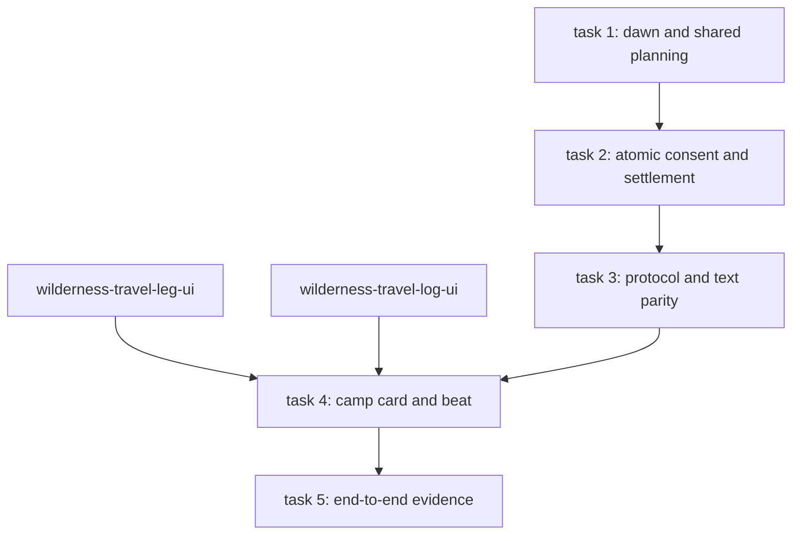

# Lightweight Wilderness Camping

**Date:** 2026-10-30
**Status:** Design approved through the blueprint, the Storybook prototype, and the dream opt-in decision on 2026-10-30. Written-spec review pending.
**Implementation status:** Not implemented by this document.
**Scope:** Sub-project 3 of the [wilderness travel mode blueprint](2026-10-30-wilderness-travel-mode-blueprint-design.md). It covers one camp decision for the whole party, a new sleep-until-dawn mode, dream opt-in at sleep entry, the campfire beat, and the forced-sleep handoff shortcut. The visual reference is the prototype in `docs/design/wilderness-travel/` (`CampCard.vue`, `CampfireCard.vue`).
**Proposals:** One OpenSpec change, `wilderness-camping`, listed with its dependency order and implementation batches in section 8.

## 1. Goal and boundaries

A long journey needs about 40 camps, so camping must be one decision: choose when to wake, optionally opt in to the dream, confirm once, watch a short beat, and continue.

This spec changes existing behaviour in two places:

- `time-skip-commands` gains a sleep-until-dawn mode.
- `dream-sleep-surface` allows the explicit dream opt-in to be given in the same action that starts the sleep.

Everything else in the sleep, possession, and dream rules is reused unchanged: party selection, safety gates, interruptible skips, events that came due, and dream sessions.

Out of scope: night ambushes, watch rolls, the ambient respawn cooldown, and the campfire illustration itself (art production).

## 2. Decisions

1. **Two wake targets.** 睡到天亮 (until the next 06:00 daypart anchor, `dawn` in `clock.yaml`) and 睡到精力全滿 (the existing until-recovered mode). The default is 睡到天亮 during dusk and night, and 睡到精力全滿 otherwise.
2. **The dream checkbox defaults off every time and is not remembered.** Ticking it is this sleep's explicit opt-in. Forced sleep never enters a dream.
3. **One server action performs the camp:** party sleep entry, the dream answer, and the continuation.
4. **The browser never computes wake times or recovered reserve.** A read-only preview supplies them.

## 3. Rules changes

### 3.1 Sleep until dawn (`time-skip-commands`)

- A new recovery mode `until-dawn` ends each member's sleep at the next occurrence of the `dawn` daypart, computed with the existing `seconds_until_daypart`. If that comes later than the configured maximum sleep, the maximum caps it.
- Text gains `sleep [all] until-dawn`, alongside the existing `until-recovered` and durations, with localized aliases 睡到天亮 and 天亮. Malformed input is still rejected before any writes.
- Browser requests select the same mode. Both command documents describe it.
- `until-dawn` follows the existing interruptible-skip and events-came-due rules unchanged.

### 3.2 Dream opt-in at entry (`dream-sleep-surface`)

- A sleep-entry request may carry `dream: true` when the requester is the authenticated owner, the owner is among the selected sleepers, and no companion is possessed. The guarded answer operation then records the explicit enter answer for that accepted sleep in the same transaction as the entry. No separate question is shown.
- `dream: false` or an absent flag records nothing. The owner-sleep question then follows the current rules, except that a camp action (section 4) records an explicit decline, so no question appears after camping.
- Every other requirement stays: the opt-in is never inferred, forced sleep never enters, a rejected sleep opens no dream, and confirmation revalidates the owner, control, and receipt.
- Text parity: `sleep all <mode> dream` carries the same opt-in. `dream enter` and `dream decline` keep working for sleeps started without it.

## 4. Protocol

### 4.1 `explore.camp_preview` (read-only)

The preview takes no input and returns:

- `available`, plus a stable refusal code and its zh-TW message when unavailable. The codes reuse the existing gates: in combat, hostile present, a member who cannot sleep, a possession conflict.
- For each mode (`until-dawn`, `until-recovered`): the predicted wake time, and for every member who would sleep, their name, current reserve, and predicted reserve at wake.
- `dream_offerable`: whether a `dream: true` request would be accepted now.
- `default_mode`, following decision 1.

It writes nothing and never ticks the clock.

### 4.2 `explore.camp` (action)

The payload is `{mode: "until-dawn" | "until-recovered", dream: boolean}`. The server:

1. runs the existing atomic party sleep entry with the chosen mode;
2. records the dream answer (an enter when `dream` is true and offerable; otherwise an explicit decline);
3. without a dream, continues the accepted sleep through the existing continuation until the members wake or the skip is interrupted;
4. with a dream, hands over to the existing dream stage, and the continuation follows the dream's existing rules.

The result carries:

- the elapsed time;
- each member's reserve before and after;
- the wake time;
- the events that came due;
- whether the skip was interrupted, and why;
- one `camp_result` travel log event (see the interface spec).

A refusal writes nothing and returns the preview's refusal code.

The text client's `camp` command is an alias of `sleep all` with the same mode and `dream` tokens, defaulting to the same mode rule as the browser.

## 5. Interface

### 5.1 Camp card

The camp card opens from 紮營 in the leg panel. It sits in the stage's `choices` anchor, uses the `choice-card` frame, takes focus, and traps Tab. It contains:

- the caption 紮營, a title `在<地點>過夜`, and the current time;
- two radio tiles, each with its label, wake time, and a one-line note (for example 天亮時全員精力全滿, or 最慢恢復的成員睡滿為止). The default tile is `default_mode`;
- for the selected tile, per member: name, a bar showing current reserve over predicted reserve, and `N% → M%`;
- the checkbox 進入夢境協作, unchecked on every open and shown only when `dream_offerable`;
- 取消 (Esc) and 全隊紮營 (Enter).

Keys: 1 and 2 pick a tile, D toggles the checkbox, Enter confirms, and Esc cancels and returns focus to 紮營.

When the preview is unavailable, the card shows the refusal message in place of the tiles, with only 取消. The 紮營 button stays enabled, so the reason is always reachable.

### 5.2 Campfire beat

After `explore.camp` succeeds without a dream, the card becomes the campfire beat, which uses the wider event-card width. It shows:

- **The scene.** The campfire illustration, with anonymous seated silhouettes painted into the art, and an animated fire glow and embers. Standing portraits are not used.
- **The party.** Medallions arc around the fire, with the far side higher. Sleepers carry a crescent. Each bar animates from the before reserve to the after reserve over 1.6 s.
- **The result line.** It appears after the bars settle, for example 「夜裡無事。全隊精力恢復至 100%，第 13 日 06:00 醒來。」. An interrupted skip says why it stopped, and any events that came due follow as further lines.
- **繼續旅程 (Enter).** Any key or click before the beat settles finishes it at once.

At motion `off`, the final state shows immediately. With a dream, the existing dream stage replaces the beat.

### 5.3 Forced-sleep handoff

When a member is forced asleep while walking, the existing handoff menu gains 全員紮營 as its first option. Choosing it opens the camp card. The other options and their behaviour are unchanged.

## 6. Art

One new scene illustration is needed: a night campfire in open country, with anonymous seated silhouettes around the fire, composed so that the medallion arc and the fire stay clear in the lower centre. Until it exists, the beat uses `forest_path` graded to night with the CSS fire, as in the prototype.

## 7. Testing

- **Rules:**
  - `until-dawn` before and after 06:00, across midnight, and capped at the maximum.
  - Interruption and events-came-due parity with `until-recovered`.
  - Text and browser parity for `sleep all until-dawn` and its aliases.
- **Dream:**
  - An enter at entry opens the dream with no question.
  - A false flag in a camp records a decline and shows no question.
  - `dream: true` is rejected when it is not offerable (a possessed companion, an awake owner excluded, or forced sleep).
  - Revalidation failure writes nothing.
- **`explore.camp_preview`:** each refusal code; wake times and reserves equal what `explore.camp` then commits; no writes.
- **`explore.camp`:** atomic refusal; a result payload with before and after reserves; a `camp_result` event.
- **vitest:**
  - The camp card: keys, default tile, the checkbox unchecked on every open, the refusal state.
  - The campfire beat: early finish and motion `off`.
- **Browser tests:** camping from the leg panel at dusk through to the map at dawn, and the handoff shortcut.

## 8. Proposed change set and implementation batches

Sub-project 3 is proposed as one OpenSpec change, `wilderness-camping`, sized to one engineer-day of runnable vertical behaviour. It lives under `openspec/changes/wilderness-camping/` and is proposal-only until applied.

| # | Change | Scope | Direct prerequisites | Sibling conflicts | Frontend visual |
| --- | --- | --- | --- | --- | --- |
| 1 | `wilderness-camping` | `until-dawn` retained deadline, entry-time dream consent and atomic camp settlement, `explore.camp_preview` and `explore.camp`, the `camp` text alias, the camp card, the campfire beat, the forced-sleep handoff shortcut | none of its own; its browser half consumes `wilderness-travel-leg-ui` (`openTravelCamp()`) and `wilderness-travel-log-ui` (`TravelEvent`, closed `camp_result` params) | `AppClient`, the exploration dispatcher and protocol fixtures, the travel store, shard manifests | **yes** — `CampCard.vue` and `CampfireCard.vue`; the handoff adds a row to the existing menu and changes no other visual |

The single proposal touches a frontend visual surface in task 4 and in the browser evidence of task 5. Tasks 1 to 3 are rules, protocol and text-command work with no new visible element: `until-dawn`, the preview, the action result and the `camp` alias change what the card can show, not any surface of their own. Task 4 carries the Storybook stories for the normal, interrupted, dream, refused and motion-off states, and task 5 carries the browser assertions; appearance and copy are human-reviewed against the prototype there. The blueprint's 1451×790 and 2560×1440 screenshot review is layout evidence for sub-project 2 and is not a requirement of this change, which adds no layout.

One change rather than several is deliberate. Camp, ordinary `sleep [all] <mode> dream` and the text `camp` alias share a single atomic entry seam (`commit_sleep_entry`), so splitting them would force a second orchestration convention for the same transaction. The preview, the action result, the card and the beat also share one result contract; a split would have to freeze that contract across changes that cannot be reviewed together.

### 8.1 Dependency order

Tasks 1 and 2 are rules-only and can run while sight and reveal rules are being applied. They are not file-disjoint from sub-project 1: `wilderness-ground-reveal` extends `world/rules/time_skip.py::continue_sleep`'s outer snapshot and clock advancement, the same module task 1.1 extends for dawn validation, and both register test modules in `.github/evennia-shards.json`. Task 3 adds the adapters, validators and text command; task 4 needs the leg and log seams as well as task 3; task 5 needs every behaviour above.

### 8.2 Parallel implementation batch

The change is a single writer on `.worktrees/wilderness-camping`; the waves below describe what may run concurrently with it, not workers inside it.

| Wave | Work in parallel | Visual? | Serialized inside the wave |
| --- | --- | --- | --- |
| 1 | Tasks 1–2 rules, concurrent with sub-project 1 rules changes | no — rules only | `world/rules/time_skip.py`, `world/rules/sleep_receipt.py`, `.github/evennia-shards.json` |
| 2 | Task 3 protocol, dispatch and text parity, concurrent with sibling client changes that touch different components | no — validators, adapters and the text command; no new surface | `exploration_actions.py`, the dispatcher injection seam, protocol parity fixtures |
| 3 | Task 4 card and beat, after `wilderness-travel-leg-ui` and `wilderness-travel-log-ui` land | **yes** — camp card, campfire beat, handoff row | `AppClient` `choices` chain, the travel store, the leg opener destination |
| 4 | Task 5 evidence and traceability | **yes** — the browser assertions drive the wave 3 surfaces | `.github/evennia-shards.json`, `.github/browser-shards.json` |

The hard serialization surface is the shared rules and client files named above: one integration owner holds `time_skip.py`, the sleep receipt surface, `AppClient`, the travel store, the protocol fixtures and the two shard manifests for the duration of a wave, because `wilderness-ground-reveal` and the sibling `wilderness-travel-*` changes edit the same files. No change in this set re-specifies party selection, safety gates, interruptible continuation, dream generation or the travel map.
