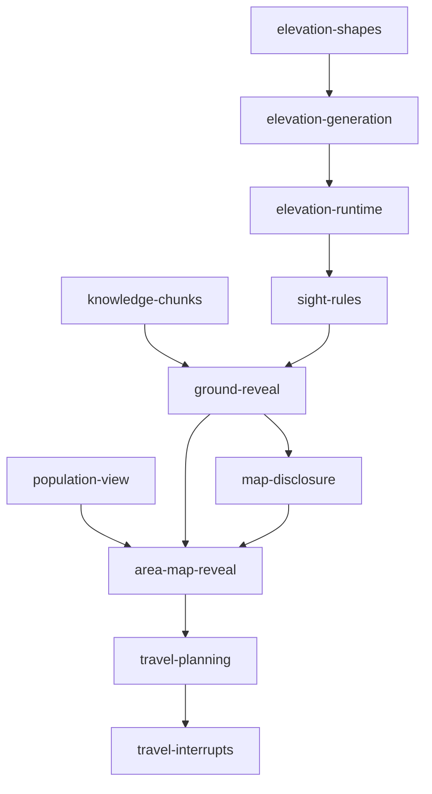

# Wilderness Sight and Fog Reveal

**Date:** 2026-10-30
**Status:** Design approved by the user section by section on 2026-10-30. Specified as eleven proposed OpenSpec changes (section 10); written-spec review pending.
**Implementation status:** Not implemented by this document.
**Scope:** Sub-project 1 of the [wilderness travel mode blueprint](2026-10-30-wilderness-travel-mode-blueprint-design.md). It defines the rules layer: ground sight, an elevation model, permanent fog reveal, distant sighting, the enlarged wilderness `area_map` window, the read-only `travel.plan` query, and per-step interrupt flags.

## 1. Goal and boundaries

A party in the wilderness sees an area around itself whose size depends on terrain, elevation, and time of day. Every cell that has entered ground sight stays revealed and can be used for route planning. Tall landmarks and settlements beyond ground sight appear as bearing-and-distance markers while they are visible. Night shrinks sight so that walking at night is a real cost.

This spec does not change presentation (sub-project 2), camping (sub-project 3), district lighting rules, movement costs, or authored game data. Values that belong to game content (landmark sight distances, elevation shapes, which landmarks are vantage points) are authored in the content files; this spec defines only their schema and how rules consume them.

No migration is provided for existing map-knowledge records. The new schema replaces schema 1, and development databases are reset.

## 2. Decisions

1. Ground sight radius depends on terrain, a per-cell elevation prominence bonus, authored vantage landmarks, and the light phase.
2. Elevation comes from an offline, deterministic, physically based model, frozen as a fingerprinted artifact. Authors can adjust it with shapes in `continent.yaml`. Linear-congruential hashes (such as the current `terrain_description` formula) are not used for terrain because they produce regular diagonal stripes.
3. Mountain passes play no role in sight rules. Mountain sight comes only from elevation.
4. District lighting still requires standing on the district's landmark cell. Seeing a landmark does not light its district.
5. A lit district reveals all of its cells directly.
6. Reveal is stored as "where the character stood and how far it could see", not as a bitmap of seen cells. Revealed cells are derived on read.
7. Distant-sighting markers exist only while currently visible. Nothing about them is stored.
8. The reveal record belongs to the `PlayerCharacter`, as map knowledge does today. Companions keep no record.

## 3. Light phases and ground sight

### 3.1 Light phases

`world/rules/rulebook/sight.yaml` defines light phases by clock hour. They are separate from the existing `clock.yaml` dayparts, which are anchor hours only.

| Phase | Hours | Radius column |
| --- | --- | --- |
| day | 07:00–17:00 | day |
| dusk | 17:00–19:00 | twilight |
| night | 19:00–05:00 | night |
| dawn | 05:00–07:00 | twilight |

A boundary hour belongs to the phase that starts at it.

### 3.2 Radius table

The ground sight radius `r` of a cell at a moment is:

```text
r = max(terrain_radius[region terrain][column] + prominence_bonus[tier][column],
        vantage_radius[column] if the cell holds a vantage landmark else 0)
```

Initial rulebook values:

| Terrain of the observer's cell | day | twilight | night |
| --- | --- | --- | --- |
| open ground, coast | 4 | 3 | 1 |
| hills and valleys | 3 | 2 | 1 |
| mountain trail | 2 | 2 | 1 |
| woodland, deep forest | 1 | 1 | 0 |

| Prominence tier | day | twilight | night |
| --- | --- | --- | --- |
| 0 | +0 | +0 | +0 |
| 1 | +1 | +0 | +0 |
| 2 | +2 | +1 | +0 |
| 3 | +3 | +2 | +0 |

| Vantage landmark | day | twilight | night |
| --- | --- | --- | --- |
| `vantage: true` | 8 | 5 | 2 |

Woodland and deep-forest cells always use tier 0, because the canopy blocks the view. The maximum radius is 8.

A cell `(x, y)` lies within radius `r` of observer `(ox, oy)` when `(x - ox)² + (y - oy)² ≤ (r + 0.5)²`. Radius 0 covers only the observer's cell. There is no line-of-sight occlusion.

### 3.3 Vantage landmarks

A landmark in `content/maps/districts.yaml` may set `vantage: true`. Which landmarks do so is content, not part of this spec.

## 4. Elevation model

### 4.1 Generation (offline)

`packages/map-core/elosern_map_core/elevation.py` generates one value per cell of the 2700 × 2700 frame, using numpy. The steps run in this order:

1. **Physical base.** Sea cells are 0. Land rises with distance from the coastline, rises strongly with proximity to the summit ridge inside the mountain corridor, and is carved down along waterways so that river cells are not higher than their banks.
2. **Relief.** Add domain-warped, multi-octave value noise (fBm) built on an integer hash with good avalanche (not a linear combination of coordinates). Amplitude depends on the region: largest in hills and valleys, small on open ground, smallest on coasts.
3. **Authored shapes.** Apply `elevation_shapes` from `continent.yaml` (section 4.2).
4. **Quantize.** Map elevation to 16 bands (0–15) for rendering contours.
5. **Prominence.** For each land cell, compare its elevation with the mean of its surrounding ring and assign tier 0–3 by thresholds. Clusters smaller than a minimum area produce no tier, so prominences read as hills, not speckle. Woodland and deep-forest cells and shapes with `no_prominence` force tier 0.

All parameters (seed, octave counts, amplitudes, thresholds, minimum area) live in one versioned generator configuration that is part of the source signature.

### 4.2 Authored shapes

`continent.yaml` gains an optional `elevation_shapes` list. Each entry has:

- `shape`: `circle` (centre cell and radius in cells) or `polygon` (cell vertices).
- `op`: `raise` or `lower` (with an amount in bands and a feather width in cells), `flatten` (to a target band, with a feather width), or `no_prominence`.
- An optional `note` for authors.

Validation rejects shapes outside the frame, self-intersecting polygons, non-positive radii or feathers, and unknown operations. Shapes apply in list order. The map editor UI for drawing shapes is a separate change.

### 4.3 Artifact

- The artifact lives under `content/maps/` next to the district partition artifact.
- Each cell is one byte: the high nibble is the band (0–15) and the low two bits are the prominence tier.
- Data is stored in 64 × 64 tiles, each zlib-compressed and base64-encoded in a JSON document with `version`, `algorithm_version`, `source_signature`, `fingerprint`, `frame_cells`, and `tile_cells`.
- Size budget: 4 MiB. If the budget is exceeded, generation fails with a clear error rather than writing the artifact.
- The regeneration command sits beside `regenerate_partition.py` in the map-data authoring skill scripts, and `check_map_sources.py` verifies that the artifact's fingerprint matches its sources.

**Source signature and fingerprint.** The signature lists the inputs: coastline, ridge, waterways, region boundaries, `elevation_shapes`, generator configuration, and algorithm version. The fingerprint hashes their content. A geography edit without regeneration fails the source check and CI, and the server refuses to load a stale artifact at startup.

### 4.4 Runtime lookup

`world/maps/elevation.py` is pure Python with no numpy dependency. It decompresses tiles on demand, holds them in an LRU cache, and exposes `band(x, y)` and `prominence_tier(x, y)`. It never scans the whole frame.

## 5. Reveal model

### 5.1 Map-knowledge schema 2

`world/rules/map_knowledge.py` moves to schema 2:

- `grid:` and `room:` visits keep the schema-1 entry shape (`first_seen_tick`, `last_seen_tick`).
- Wilderness visits are grouped by 64 × 64 chunk. Each entry holds `first_seen_tick`, `last_seen_tick`, and `sight`, the largest ground sight radius the character has had on that cell (0–8).
- Reads parse only the chunks they need.
- Schema-1 records are rejected as unknown, with the existing corrupt-record diagnostics. No conversion is attempted.

### 5.2 When `sight` is written

- On arrival at a wilderness cell, inside the existing movement transaction, `sight = max(stored sight, radius at arrival)`.
- On completing a time skip (wait, sleep, camp) at a wilderness cell, inside that skip's transaction, `sight = max(stored sight, radius at the skip's end)`.
- `sight` never decreases. Pure reads never write. A failed or rolled-back transaction leaves the record unchanged, as `MovementSnapshot` does today.

### 5.3 Revealed predicate

A wilderness cell is revealed for a character when either condition holds:

1. Its district is lit for the character. The whole district is revealed without any union computation.
2. Some visit record `v` within 8 cells has the cell inside the disc of radius `v.sight` around `v`'s cell (section 3.2).

The lookup reads only the chunks that intersect the query area expanded by 8 cells.

A revealed cell exposes terrain class, passability, elevation band, prominence tier, road and ford flags, and non-hidden locations. Hidden point entries and elven villages still appear only after the character visits them. Reveal shows only the terrain of their cells.

### 5.4 Live sight

Live sight is the disc of the current radius around the party's current cell. It is never persisted. It carries what changes over time:

- **Hostile and other entities.** Their visibility is computed by a read-only population view that applies the same deterministic rules as `ensure_population` (baseline hash, hunting band, monster sites, currently registered entities) without creating or registering objects. `ensure_population` and the view share one rule function, so they cannot diverge.
- **Distant-sighting markers** (section 6).

Revealed cells outside live sight show no entities.

## 6. Distant sighting

Sources:

- **Landmarks** with an optional `sight_km` (daytime visibility), an optional `light_km` (night visibility, for light sources such as lighthouses), and a `silhouette_zh` description, for example 「一座石塔」.
- **Non-hidden settlements.** Daytime visibility comes from their footprint size, and at night they appear as light sources.

Visibility by light phase:

- **day:** full `sight_km`.
- **twilight:** `sight_km` multiplied by a rulebook factor.
- **night:** only sources with night visibility.

Elevation does not change sighting distance.

A source produces a marker when its distance from the party is within its current visibility and its cell is not inside live sight. A party standing on a woodland or deep-forest cell sees no markers, because the canopy hides the horizon. A marker carries:

- one of 16 compass bearings, named in zh-TW (for example 北北東);
- the distance rounded to the nearest 5 km;
- the silhouette description;
- the landmark name, only if its district is lit for the character.

Markers are recomputed on each read and never stored.

## 7. Protocol

### 7.1 Wilderness `area_map`

- The window grows from 15 × 15 to 41 × 41 cells (radius 20), centred on the party, with no panning beyond it.
- Cells are sent as run-length-encoded rows. Each run carries terrain class, elevation band, prominence tier, and road/ford flags. Unrevealed cells are a dedicated "unknown" run and carry no other information.
- The payload also carries live-sight entities, distant-sighting markers, the current light phase, and the current ground radius.
- Estimated encoded cell data is about 2 KB. The payload uses the existing publication chunking.

### 7.2 `travel.plan` (read-only)

Input:

- `destination`: a cell inside the current window that is revealed.
- `pace`: `cautious`, `standard`, or `forced`.
- `stop_at_night`: a boolean.

Behaviour:

- A* over revealed, passable cells inside the window, eight-directionally, with the existing diagonal two-orthogonal rule. The step cost is the predicted duration from `travel_cost`, so roads are preferred naturally.
- At most 60 steps.
- Fatigue prediction uses the existing pure reserve prediction for every present traveller, and the party moves at its slowest member's speed.
- It writes nothing and never ticks the clock.

Output:

- For each step: its cell, its duration in seconds, and the predicted worst fatigue stage among travellers after the step.
- `nightfall_index`: the first step during which the light phase becomes night, or null.
- `stop_index` and `stop_reason`.

Stop rules:

- `cautious`: stop after the step during which any traveller enters light fatigue.
- `standard`: stop after the step during which any traveller enters moderate fatigue.
- `forced`: stop before the first step that preflight would refuse.
- `stop_at_night`: stop after `nightfall_index` if that comes earlier.

Stable error codes:

| Code | Meaning |
| --- | --- |
| `plan_destination_outside_window` | The destination is outside the current window |
| `plan_destination_unrevealed` | The destination has not been revealed |
| `plan_unreachable` | No path exists over revealed, passable cells |
| `plan_too_long` | The route needs more than 60 steps |
| `plan_party_cannot_travel` | A traveller is asleep, or preflight refuses the first step |

### 7.3 `explore.move` walk context and interrupt flags

`explore.move` accepts an optional `walk: {pace, stop_at_night}`. The server keeps no walking state between requests. After a successful step, the result carries the interrupt flags that apply:

| Flag | Raised when |
| --- | --- |
| `landmark_reached` | The party arrived on a district landmark cell |
| `district_lit` | This step lit a district |
| `landmark_sighted` | A distant-sighting marker exists after the step that did not exist before it |
| `hostile_in_sight` | A hostile entity is in live sight after the step that was not in live sight before it |
| `pace_threshold` | With `walk` present, a traveller entered the pace's threshold stage during the step |
| `nightfall` | With `walk.stop_at_night` true, the light phase became night during the step |
| `member_asleep` | A traveller's posture became voluntary or forced sleep |

Flags are computed by comparing state before and after the committed step. A refused or rolled-back step carries no flags. The existing refusal results are unchanged.

## 8. Units

| Unit | Responsibility | Depends on |
| --- | --- | --- |
| `packages/map-core/elosern_map_core/elevation.py` | Offline elevation, shapes, quantization, prominence; artifact encoding | Terrain definition, generator config |
| Elevation artifact under `content/maps/` | Frozen per-cell band and tier | Generated |
| `world/maps/elevation.py` | Runtime tile lookup with LRU cache | Artifact |
| `world/rules/rulebook/sight.yaml` | Light phases and every radius and factor table | — |
| `world/rules/sight.py` | Pure light phase, ground radius, live-sight disc, distant markers | Rulebook, elevation, terrain, landmarks, settlements |
| `world/rules/map_knowledge.py` | Schema 2, `sight` writes, revealed predicate, window query | `sight`, district lighting |
| Population view (beside `wilderness_population.py`) | Read-only entity visibility sharing the `ensure_population` rule | Population rules |
| `world/rules/travel_plan.py` | `travel.plan` routing and prediction | Map knowledge, `travel_cost`, reserve prediction, `sight` |
| `world/rules/travel_interrupts.py` | Before/after comparison producing interrupt flags | `sight`, map knowledge, reserve, population view |
| `web/webclient/presentation/area_map.py` | 41 × 41 window, run-length encoding, entities, markers | All of the above |

## 9. Error handling

- A stale or corrupt elevation artifact stops server startup with a diagnostic that names the mismatched source.
- A corrupt map-knowledge record keeps today's behaviour: diagnostics are logged, the record is never overwritten, and presentation treats only lit districts as revealed.
- `travel.plan` returns only the stable error codes in section 7.2 and never raises to the client.
- Interrupt-flag computation failures are logged and produce no flags. They never fail an otherwise successful step.

## 10. Proposed change set

The rules layer is planned as eleven OpenSpec changes, all sized at one workday including focused evidence and documentation, all still `phase=proposed`. Each owns one new capability and, where it changes an existing contract, the explicit `MODIFIED` requirement blocks it replaces.

| # | Change | New capability | Frontend visual | Depends on |
| --- | --- | --- | --- | --- |
| 1 | `wilderness-elevation-shapes` | `wilderness-elevation-authoring` | none | — |
| 2 | `wilderness-elevation-generation` | `wilderness-elevation-generation` | none | 1 |
| 3 | `wilderness-elevation-runtime` | `wilderness-elevation-runtime` | none | 2 |
| 4 | `wilderness-sight-rules` | `wilderness-sight` | none | 3 |
| 5 | `wilderness-knowledge-chunks` | `wilderness-knowledge-chunks` | none | — |
| 6 | `wilderness-ground-reveal` | `wilderness-ground-reveal` | none | 4, 5 |
| 7 | `wilderness-population-view` | `wilderness-population-view` | none | — |
| 8 | `wilderness-map-disclosure` | `wilderness-map-disclosure` | data | 6 |
| 9 | `wilderness-area-map-reveal` | `wilderness-area-map-reveal` | render | 6, 7, 8 |
| 10 | `wilderness-travel-planning` | `wilderness-travel-planning` | none | 9 |
| 11 | `wilderness-travel-interrupts` | `wilderness-travel-interrupts` | none | 10 |

Frontend visual column: `none` is server or offline only; `data` changes values an existing frontend view already renders, with no component, style or story edit; `render` edits frontend rendering code.

- Change 9 is the only one that edits view code (`AreaMapView.vue`, `lib/area_map_view.js`) and its Vitest view assertions, and it changes what the area map draws: unknown versus revealed terrain, remembered-but-unvisited cells, entities and markers.
- Change 8 changes only inputs the existing compass and minimap already render — a nullable destination, a generic direction label instead of leaked terrain or identity — so it is player-visible without touching a component, style or story.
- Change 11 extends frontend result-data validators only. Nothing renders interrupt flags until sub-project 2, which is why it is `none`.

Modified existing capabilities: `map-knowledge` (5, 6), `webclient-local-map`, `webclient-exploration-menu` and `webclient-exit-compass` (8), `webclient-area-map` and `webclient-map-panel-protocol` (9), `webclient-exploration-menu` again for the optional walk form (11).

### 10.1 Dependency graph



`knowledge-chunks` and `population-view` are independent roots; every other edge is a real prerequisite (a shared writer, a payload the consumer decodes, or a projection the dependent reads).

### 10.2 Parallel implementation batch

One change per worker and one worker per `.worktrees/<change>`; a wave may run its members concurrently. Only wave 1 widens beyond a single worker; the critical path is the elevation and reveal chain.

| Wave | Changes in parallel | Why they may run together |
| --- | --- | --- |
| 1 | 1 `elevation-shapes`, 5 `knowledge-chunks`, 7 `population-view` | Three independent roots with no shared owner |
| 2 | 2 `elevation-generation` | Needs the validated shape schema |
| 3 | 3 `elevation-runtime` | Needs generated tiles |
| 4 | 4 `sight-rules` | Reads the runtime elevation lookup |
| 5 | 6 `ground-reveal` | Needs chunk storage and the sight functions |
| 6 | 8 `map-disclosure` | Needs the reveal predicate |
| 7 | 9 `area-map-reveal` | Needs reveal, population projection and the disclosure payload |
| 8 | 10 `travel-planning` | Routes over the revealed window |
| 9 | 11 `travel-interrupts` | Extends the planned walk contract |

Ordering inside the batch that is not a build dependency:

- `map-disclosure` lands before `travel-interrupts`; both modify `webclient-exploration-menu` and the exploration move-row payload, so the schema 5→6 nullable-destination cutover is integrated first and the optional `walk` field is added on top of it.
- `map-disclosure` also lands before `area-map-reveal`, which stops assuming an unchanged `ExitCompass` for unknown neighbours.
- All server slices may touch `.github/evennia-shards.json`, the protocol documents and the frozen parity audits; one integration owner serializes those edits even when the waves above run concurrently.

## 11. Testing

- **Elevation:**
  - The same inputs produce the same bytes.
  - Physical invariants hold: sea is 0, the ridge corridor holds the highest bands, river cells are not higher than their banks, and woodland has tier 0.
  - Shapes apply in order, and their validation rejects bad input.
  - Directional autocorrelation shows no periodic spikes, which guards against stripe patterns.
  - The artifact stays within its size budget, and the fingerprint check fails after a geography edit without regeneration.
- **Sight:** boundary values for every terrain, light-phase boundary hour, prominence tier, and vantage landmark; the woodland override; the disc formula at radii 0 and 8; no distant-sighting markers from woodland cells.
- **Reveal:**
  - `sight` only increases and updates after a wait at the same cell.
  - Reads write nothing, and rollback leaves the record unchanged.
  - The lit-district shortcut agrees with the union computation.
  - Hidden entries need a visit.
  - Schema-1 records are rejected.
- **Anti-peek:** the payload never contains an unrevealed cell or an entity outside live sight.
- **Population view:** for sampled cells, the view equals what `ensure_population` then creates on entry.
- **`travel.plan`:**
  - Routing goes around rivers, honours the diagonal rule, and prefers roads.
  - Each error code has a test.
  - The query writes nothing and never ticks the clock.
  - Predicted per-step stages and durations equal the settlement of walking the same steps one by one.
- **Interrupt flags:** each flag has a raising case and a non-raising case; refused steps carry no flags.
- **Performance:** with 20,000 wilderness visit records, building the window payload takes at most 50 ms and `travel.plan` at most 100 ms on the development machine.

## 12. Out of scope

- Presentation of the map, markers, and routes (sub-project 2).
- Camping (sub-project 3).
- Map editor tools for `elevation_shapes`.
- Line-of-sight occlusion, weather, seasons, and moon phases.
- Changes to authored geography or other game data.
